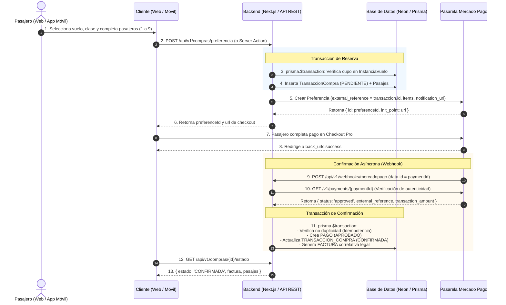

# Especificación Técnica: Integración de Pagos con Mercado Pago (Checkout Pro)

Este documento detalla el diseño técnico, la interacción de entidades, el diagrama de secuencia y los contratos de API necesarios para integrar la pasarela de pagos **Mercado Pago** en modo **Checkout Pro (Sandbox y Producción)** en el sistema de la aerolínea.

---

## 1. Decisiones de Diseño y Arquitectura

1. **Modalidad Checkout Pro:**
   - Se delega la captura segura de datos sensibles a la pasarela oficial de Mercado Pago mediante una **Preferencia de Pago** generada en el servidor con el SDK oficial (`mercadopago`).
   - Reduce la superficie de ataque y costos de certificación PCI-DSS.
2. **Confirmación Asíncrona e Idempotente vía Webhook:**
   - La confirmación comercial y fiscal de la compra **nunca depende del retorno del usuario en el navegador (`back_urls`)**, sino exclusivamente de la notificación asíncrona del servidor de Mercado Pago (`notification_url` / Webhook).
   - El webhook valida la autenticidad del evento realizando una consulta inversa a `GET /v1/payments/{id}` antes de mutar la base de datos.
   - Manejo estricto de **idempotencia**: si el webhook se reenvía para un pago ya registrado, se responde `200 OK` sin duplicar pagos ni facturas.
3. **Variables de Entorno Requeridas:**
   ```env
   MERCADOPAGO_ACCESS_TOKEN="TEST-xxxxxxxx-xxxx-xxxx-xxxx-xxxxxxxxxxxx"
   NEXT_PUBLIC_MERCADOPAGO_PUBLIC_KEY="TEST-xxxxxxxx-xxxx-xxxx-xxxx-xxxxxxxxxxxx"
   MERCADOPAGO_WEBHOOK_SECRET="xxxxxxxxxxxxxxxxxxxxxxxxxxxxxxxx"
   ```

---

## 2. Interacción con Entidades del Modelo de Datos

| Entidad | Rol en el Flujo de Pago | Operación / Restricción |
| :--- | :--- | :--- |
| `VUELO` | Catálogo y Tarifas | Lectura de tarifas (`precioEconomy`, `precioPrimera`) y capacidades máximas configuradas. |
| `INSTANCIA_VUELO` | Control de Cupo | Verificación transaccional de cupo disponible antes de crear la preferencia: <br>`cupoDisponible = capacidadClase - COUNT(pasajes activos) >= cantidadPasajes`. |
| `USUARIO` | Comprador | Si el usuario está autenticado (Clerk), se asocia `usuarioId`. Si opera como invitado, `usuarioId = NULL`. |
| `TRANSACCION_COMPRA` | Orden Comercial | Se crea con `estado = 'PENDIENTE'` y `total = sum(pasajes)`. Su `id` numérico se envía a Mercado Pago como `external_reference`. Pasa a `'CONFIRMADA'` tras la aprobación del cobro. |
| `PASAJE` | Billetes (1 a 9) | Se registran vinculados a la transacción con `estado = 'EMITIDO'` condicionado a la confirmación del pago. Si el pago falla/expira, pasan a `'CANCELADO'`. |
| `PAGO` | Registro Transaccional | Relación 1:1 con `TransaccionCompra`. Almacena `idTransaccionPasarela` (ID de pago MP), `metodoPago`, `monto` (idéntico al total) y `estado = 'APROBADO'`. |
| `FACTURA` | Comprobante Fiscal | Relación 1:1 con `TransaccionCompra`. Se emite automáticamente tras confirmarse el pago aprobado, generando número correlativo legal único (ej. `FC-B-0001-XXXXXXXX`). |

---

## 3. Diagrama de Secuencia del Proceso de Compra



---

## 4. Nuevos Endpoints REST para la App Móvil (`/api/v1/...`)

### 4.1. Crear Preferencia de Compra
- **Ruta:** `POST /api/v1/compras/preferencia`
- **Descripción:** Valida cupos, inicia la orden de compra y genera la preferencia de Mercado Pago.
- **Autenticación:** Opcional (Bearer Token si está logueado; `null` para invitados).
- **Request Body:**
  ```json
  {
    "instanciaVueloId": "104",
    "clase": "ECONOMY",
    "emailContacto": "pasajero@ejemplo.com",
    "pasajeros": [
      {
        "nombre": "Juan",
        "apellido": "Pérez",
        "documento": "38123456",
        "numeroAsiento": null
      }
    ],
    "facturacion": {
      "tipoFactura": "B",
      "nombreRazonSocial": "Juan Pérez",
      "identificacionFiscal": "38123456"
    }
  }
  ```
- **Response `201 Created`:**
  ```json
  {
    "success": true,
    "data": {
      "transaccionId": "502",
      "preferenceId": "123456789-abcd-ef01-2345-6789abcdef01",
      "initPoint": "https://sandbox.mercadopago.com.ar/checkout/v1/redirect?pref_id=...",
      "total": 85000.00
    }
  }
  ```
- **Errores:** `400 VALIDATION_ERROR` · `404 INSTANCIA_NO_ENCONTRADA` · `409 SIN_CUPO` / `VUELO_NO_DISPONIBLE` / `INSTANCIA_CANCELADA` · `500 PAYMENT_GATEWAY_NOT_CONFIGURED` / `INTERNAL_ERROR` · `502 PAYMENT_GATEWAY_UNAVAILABLE`.

### 4.2. Webhook de Notificaciones de Mercado Pago
- **Ruta:** `POST /api/v1/webhooks/mercadopago`
- **Descripción:** Endpoint público que recibe notificaciones de eventos (`payment.created`, `payment.updated`).
- **Validación:** Verifica el pago directamente en la API de Mercado Pago y procesa la transacción de forma idempotente.
- **Response `200 OK`:**
  ```json
  { "received": true }
  ```

### 4.3. Consulta de Estado de Compra
- **Ruta:** `GET /api/v1/compras/:id/estado`
- **Descripción:** Consulta el estado actual de la transacción, el pago y la factura generada (útil para polling o pantalla de éxito en la app móvil).
- **Response `200 OK`:**
  ```json
  {
    "success": true,
    "data": {
      "transaccionId": "502",
      "estado": "CONFIRMADA",
      "total": 85000.00,
      "pago": {
        "estado": "APROBADO",
        "metodoPago": "TARJETA_CREDITO",
        "idTransaccionPasarela": "9876543210"
      },
      "factura": {
        "numeroFactura": "FC-B-0001-00000502",
        "tipoFactura": "B",
        "total": 85000.00
      },
      "pasajes": [
        {
          "codigo": "1001",
          "pasajero": "Juan Pérez",
          "clase": "ECONOMY",
          "estado": "EMITIDO"
        }
      ]
    }
  }
  ```
- **Errores:** `404 TRANSACCION_NO_ENCONTRADA`.

---

## 4.4. Contrato Uniforme de Respuestas

Todas las respuestas de la API REST v1 respetan el mismo sobre:

- **Éxito:** `{ "success": true, "data": ... }` (excepto el webhook, que responde `{ "received": true }`).
- **Error:** `{ "success": false, "error": { "code": "...", "message": "..." } }`.

Los códigos de error de dominio llevan su status HTTP semántico asociado (`400`, `401`, `404`, `409`, `500`, `502`); los errores no controlados degradan a `500 INTERNAL_ERROR` sin filtrar detalles internos.

---

## 5. Reglas de Implementación Críticas

1. **Conversión de `BigInt`:** Dado que en Prisma los IDs de `TransaccionCompra`, `Pago` y `Pasaje` son `BigInt`, siempre serializar a `string` (`id.toString()`) al comunicarse con Mercado Pago (`external_reference`) o enviar JSON.
2. **Control de Concurrencia:** La verificación de cupo disponible debe realizarse dentro del bloque `prisma.$transaction` antes de crear la transacción.
3. **Manejo de Reintentos:** Si Mercado Pago reenvía un webhook (`retry`), comprobar si ya existe un `Pago` para ese `transaccionId` o si `TransaccionCompra.estado === 'CONFIRMADA'` para evitar duplicación.
